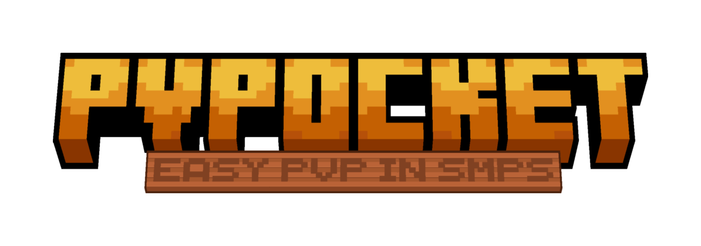

  

  <strong>中文</strong> | <a href="docs/en/README.md">English</a>

<h1 align="center">PvPocket（口袋决斗）</h1>

在 SMP 生存服里开一个与生存完全隔离的「决斗口袋」：几名玩家在独立场地里按谈妥的规则打多局，结束后背包、经验、血量、位置全部还原，生存世界的地形不会被碰到。

<strong>两个人想打一场，三十秒内能开打，打完什么痕迹都不留。</strong>

  <a href="#它能做什么">能做什么</a> · <a href="#一场决斗长什么样">怎么开一局</a> ·
  <a href="#运行要求">运行要求</a> · <a href="#安装">安装</a> · <a href="#文档">文档</a>

---

| 一眼看清 | |
| --- | --- |
| 规则 | 38 条（37 项可配置 + 1 条只读冲突提示），七组；改动会让先前的「同意」自动作废 |
| 战斗 | 现代（1.9+ 攻击冷却、盾牌）与经典 1.8（无冷却、剑格挡、1.8 击退与伤害），逐场切换 |
| 赛制 | 最多 15 局，单局可设时长上限；每局之间完整重置，比分累积到决出胜者 |
| 人数 | 最多 4 方 × 每方 5 人 = 20 人 |
| 场地 | 5 张内置地图 + 一张运行时平坦图，独立维度分格，可加副本 |
| 配装 | 逐项配置，能存预设；分享码 5 分钟有效，导入后落盘到本机 |
| 构建 | 6 个 cell：1.21.1 / 1.21.11 / 26.1，各一份 Fabric 与 NeoForge |
| 许可 | 代码 LGPL-3.0；四张第三方地图 CC BY-SA 4.0 |

> [!TIP]
> 为了良好的ui观感，强烈使用材质包/模组替换原版像素风格字体

## 它能做什么

- **规则先谈再打**：七组 38 条规则，开局前双方在同一块面板上逐条谈，全部同意才开打。规则带版本号，任何一方改了规则，之前收到的「同意」自动作废。
- **两种战斗模式**：现代与经典 1.8，逐场切换。经典模式关掉攻击冷却，按 1.8 的公式重算击退、格挡与护甲。
- **多局赛制**：最多 15 局，单局时长上限与超时判定可配；每局之间完整重置，比分累积。
- **自定义配装**：武器、护甲、消耗品逐项配置。附魔跟着物品类型走——三叉戟的忠诚 / 激流 / 无三选一、鞘翅的烟花飞行时长、弓的无限与箭矢数量、末影水晶配黑曜石、TNT 配打火石。预设可以存下来，也能生成 5 分钟有效的分享码；对方导入后落盘到本地，下次不用再要码。
- **观战**：自由视角，或把相机绑到某个选手身上，底部显示实时血量与装备。
- **打完不留痕**：背包、经验、血量、饥饿、位置、游戏模式、状态效果逐项还原，掉在地上的物品也算在内。决斗维度是独立维度，生存世界的地形不会被碰到。
- **兜底**：掉线判负、滞留玩家保护、地形保护与复原、场地可重建。

## 一场决斗长什么样

1. 甲敲 `/pvpocket duel`，规则面板弹出，落在玩家页，默认两张队伍卡片。
2. 把人放进卡片、拖滑杆调规则；乙在自己的面板上看到同一份草案。
3. 双方各自配装，可以载入预设。
4. 双方点「同意并开始」——规则与配装一起锁定，倒计时后传送进场。
5. 打满设定的局数，胜者出现；几秒后所有人回到原位置，状态复原。

面板被 Esc 关掉后用 `/pvpocket review` 重新打开。

## 规则能调什么

| 组      | 管什么        | 例子                              |
| ------ | ---------- | ------------------------------- |
| A 对局结构 | 局数、胜负与时间   | 几局几胜、单局上限、超时判谁赢                 |
| B 参与者  | 人数、队伍与误伤   | 每队几人、最多几人、友伤开关                  |
| C 战斗   | 战斗模式与生存参数  | 现代 / 经典 1.8、最大生命、自然回血、饥饿、击退抗性   |
| D 配装   | 进场物品与拾取    | 是否允许局间换装、拾取、合成、消耗品              |
| E 场地   | 场地、边界与环境伤害 | 地图、尺寸、边界规则、时间、天气、环境危害（含掉落伤害）      |
| F 方块   | 放置、破坏与爆炸   | 能否放置、地形保护、方块白名单、爆炸物             |
| G 其他   | 珍珠、投降与显示   | 末影珍珠、投降、对手血量显示、聊天范围             |

完整含义与每一条的实际效果见 [`docs/zh/02-rules.md`](docs/zh/02-rules.md)。

## 运行要求

| Minecraft | 加载器 | Java | 额外依赖 |
| --- | --- | --- | --- |
| 1.21.1 | Fabric / NeoForge | 21 | Fabric 格需要 Fabric API |
| 1.21.11 | Fabric / NeoForge | 21 | 同上 |
| 26.1（构建用的是 26.1.2） | Fabric / NeoForge | 25 | 同上 |

每个版本的确切坐标在 [`gradle/catalogs/`](gradle/catalogs/)，一个 MC 版本一份 `.toml`。

**服务端与客户端必须装同一个模组、同一个版本。** 两端协议是自定义 payload，版本不一致时表现为面板不出现或规则不生效，而不是一条明确的报错。

六格都能构建，联调程度不一样：26.1 的 Fabric 与 NeoForge 两格连服实测过（进服、规则面板、配装编辑器），1.21.11 两格目前只做到编译通过。1.20.1 与 26.2 / 26.3 还在规划里，矩阵见 [`versions/README.md`](versions/README.md)。

## 安装

1. 取 `dist/<cell>/` 里对应格子的 jar，放进服务端的 `mods/`。自己构建跑 `./gradlew buildAll`，产物按格子分放在 `dist/` 下。
2. Fabric 格再放一份 [Fabric API](https://modrinth.com/mod/fabric-api)；NeoForge 格不需要它。
3. 每个要参战的客户端放同样的 jar（以及对应的 Fabric API）。没有客户端就没有规则面板、配装编辑器和计分板。
4. 首次启动会在存档下生成 `pvpocket/` 目录（`journal`、`homes.json`、`guard.json`）。5 张内置地图在启动时逐 tick 贴好，约需 10 秒；这期间 `/pvpocket arena` 会显示「分区尚未布置」，此时无法开局。

部署细节、权限、运维与排障见 [`docs/zh/05-usage.md`](docs/zh/05-usage.md)。

## 不做什么

不做匹配与排队，不做排行榜，不做跨服，不做回放。统计与历史存在各自服务器的存档里，换一个服务器就是另一份。

## 文档

规范文档在 [`docs/`](docs/)，中英双语，`zh/` 与 `en/` 平行、篇目一一对应。

| 想知道                 | 读                                 |
| ------------------- | --------------------------------- |
| 这是什么、四个核心决定、功能边界    | [`01 概览`](docs/zh/01-overview.md) |
| 38 条规则的完整清单与含义      | [`02 规则`](docs/zh/02-rules.md)    |
| 部署、权限、玩家流程、指令、运维、排障 | [`05 使用`](docs/zh/05-usage.md)    |
| 每个版本改了什么            | [`CHANGELOG`](CHANGELOG.md)       |
| 要改代码、加地图、报问题        | [`CONTRIBUTING`](CONTRIBUTING.md) |

实现细节在 [`03 架构`](docs/zh/03-architecture.md)、[`04 视觉`](docs/zh/04-visual.md)、
[`06 地图`](docs/zh/06-maps.md)，面向改代码的人。给编码代理的硬约定在 [`AGENTS.md`](AGENTS.md)。

## 许可

模组代码按 **GNU Lesser General Public License v3.0** 分发，全文见 [`LICENSE`](LICENSE)。  
LGPL-3.0 引用 GPL-3.0 的条款，其副本见 [`LICENSE-GPL-3.0.txt`](LICENSE-GPL-3.0.txt)。  
`fabric.mod.json` 中的 SPDX 标识为 `LGPL-3.0-only`。

**发布的 jar 里带一份。** `LICENSE`、`LICENSE-GPL-3.0.txt` 与 `THIRD-PARTY-NOTICES.md` 会被
`processResources` 打进 jar 根目录——LGPL-3.0 §4 要求收到二进制的人同时收到许可副本，而实际被分发的
是 jar，不是这个仓库。解压 jar 就能看到，许可证扫描器也读得到。

**内置地图不受此影响**：五张地图中四张来自 [zzuf-maps](https://github.com/zzufx/zzuf-maps)，按  
**CC BY-SA 4.0** 分发；斗兽场由 `scripts/map/colosseum.py` 生成，无第三方义务。署名与改动声明见  
[`THIRD-PARTY-NOTICES.md`](THIRD-PARTY-NOTICES.md)。
