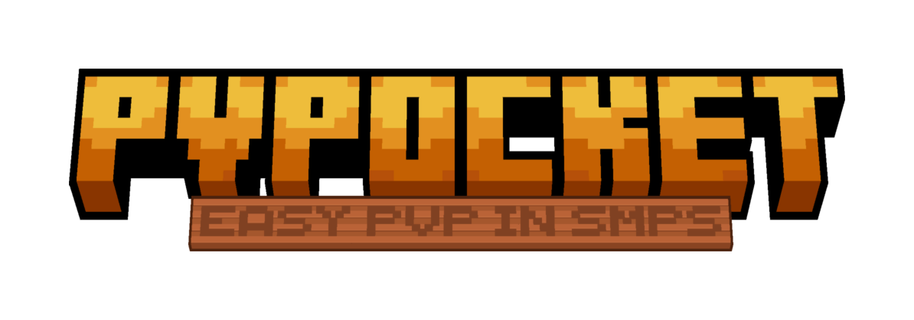

  

  <a href="../../README.md">中文</a> | <strong>English</strong>

<h1 align="center">PvPocket</h1>

An isolated duel pocket inside a survival SMP: a few players fight a best-of-N in a dedicated arena under terms they negotiated, then leave with inventory, experience, health and position restored. The survival world is never touched.

<strong>Two people want a fight, it starts in thirty seconds, and it leaves no trace.</strong>

  <a href="#what-it-does">What it does</a> · <a href="#what-a-duel-looks-like">A duel</a> ·
  <a href="#requirements">Requirements</a> · <a href="#installation">Install</a> ·
  <a href="#documentation">Docs</a>

---

| At a glance | |
| --- | --- |
| Rules | 38 entries (37 configurable + one read-only conflict note), seven groups; any edit voids earlier agreement |
| Combat | Modern (1.9+ cooldown, shields) and Classic 1.8 (no cooldown, sword blocking, 1.8 knockback and damage), switched per match |
| Series | Up to 15 rounds, optional per-round limit; each round resets fully while the score carries over |
| Players | Up to 4 sides x 5 players each = 20 people |
| Arenas | Five built-in maps plus a runtime flat plot, in separate cells of a dedicated dimension; copies can be added |
| Loadouts | Configured item by item, saved as presets; share codes last five minutes and land on disk once imported |
| Builds | Six cells: 1.21.1 / 1.21.11 / 26.1, one Fabric and one NeoForge each |
| Licence | Code under LGPL-3.0; four third-party maps under CC BY-SA 4.0 |

> [!TIP]
> The interface was laid out for a non-pixel font. Install a resource pack or font mod that replaces the vanilla bitmap font to see it as designed.

## What it does

- **Terms before fighting**: seven groups, 38 rules. Both sides walk through the same panel before the first round, and nothing starts until everyone agrees. Rules carry a revision number, so any edit invalidates the earlier "yes".
- **Two combat modes**: modern and Classic 1.8, switched per match. Classic turns off the attack cooldown and recomputes knockback, blocking and armour with the 1.8 formulas.
- **Best-of-N**: up to 15 rounds, with a configurable per-round time limit and timeout verdict. Every round resets completely; the score carries over.
- **Custom loadouts**: weapons, armour and consumables configured item by item. Enchantments follow the item type — a trident picks one of Loyalty / Riptide / neither, an elytra has a firework flight duration, a bow has Infinity and an arrow count, an end crystal comes with obsidian, TNT with flint and steel. A loadout can be saved as a preset, and a preset can be published as a share code valid for five minutes; whoever imports it keeps it locally.
- **Spectating**: free camera, or lock the camera to a fighter with their health and gear on the spectator bar.
- **No trace**: inventory, experience, health, hunger, position, game mode and status effects restored field by field, dropped items included. The duel dimension is separate, so the survival world is never touched.
- **Safety nets**: disconnect forfeit, stray-player protection, terrain protection and restore, arena rebuild.

## What a duel looks like

1. Player A runs `/pvpocket duel`; the rule panel opens on the players page with two team cards.
2. Put people on the cards and drag the sliders; player B sees the same draft on their own panel.
3. Both sides build a loadout, optionally from a preset.
4. Both press "Accept & start" — rules and loadouts lock together, a countdown runs, and everyone is teleported in.
5. After the agreed number of rounds a winner is declared; a few seconds later everyone is back where they started, restored.

If the panel is closed with Esc, `/pvpocket review` reopens it.

## What the rules cover

| Group             | Scope                           | Examples                                                                           |
| ----------------- | ------------------------------- | ---------------------------------------------------------------------------------- |
| A Match structure | Rounds, victory, time           | Rounds to win, per-round limit, timeout verdict                                    |
| B Participants    | Players, teams, friendly fire   | Team size, player cap, friendly-fire toggle                                        |
| C Combat          | Combat mode and survival stats  | Modern / Classic 1.8, max health, natural regen, hunger, knockback resistance       |
| D Loadout         | Entry items and pickup          | Swapping between rounds, pickup, crafting, consumables                             |
| E Arena           | Map, bounds, environment        | Map, size, boundary rule, time of day, weather, hazards (incl. fall damage)        |
| F Blocks          | Placement, breaking, explosions | Placement, terrain protection, block filter, explosives                            |
| G Other           | Pearls, surrender, display      | Ender pearls, surrender, opponent health, chat scope                               |

Full meanings, and what each one actually changes, are in [`02-rules.md`](02-rules.md).

## Requirements

| Minecraft | Loaders | Java | Extra dependency |
| --- | --- | --- | --- |
| 1.21.1 | Fabric / NeoForge | 21 | Fabric API for the Fabric cell |
| 1.21.11 | Fabric / NeoForge | 21 | Same as above |
| 26.1 (built against 26.1.2) | Fabric / NeoForge | 25 | Same as above |

Exact coordinates for each version live in [`gradle/catalogs/`](../../gradle/catalogs/), one `.toml` per Minecraft version.

**Server and client must run the same build of the mod.** The protocol is custom payloads; a version mismatch shows up as a panel that never appears or rules that never apply, not as a clear error.

All six cells build, but they are not equally exercised: the Fabric and NeoForge cells for 26.1 were connected to a live server (join, rule panel, loadout editor), while 1.21.11 has only been compile-checked. 1.20.1, 26.2 and 26.3 are planned. The matrix is in [`versions/README.md`](../../versions/README.md).

## Installation

1. Take the jar for your cell from `dist/<cell>/` and drop it into the server's `mods/`. To build it yourself, run `./gradlew buildAll`; output is grouped by cell under `dist/`.
2. Fabric cells also need [Fabric API](https://modrinth.com/mod/fabric-api). NeoForge cells do not.
3. Put the same jar (and Fabric API where needed) on every client that will fight — without the client there is no rule panel, no loadout editor and no scoreboard.
4. First start creates `pvpocket/` inside the world save (`journal`, `homes.json`, `guard.json`). The five built-in maps are pasted tick by tick, which takes about ten seconds; until it finishes `/pvpocket arena` reports that the cells are not laid out yet and no match can start.

Deployment details, permissions, operations and troubleshooting are in [`05-usage.md`](05-usage.md).

## What it does not do

No matchmaking or queue, no leaderboard, no cross-server play, no replay. Stats and history live in each server's world save, so another server is a separate record.

## Documentation

The specification lives in [`docs/`](../) — Chinese under [`zh/`](../zh/), English under `en/`, parallel and one-to-one.

| Want to know                                               | Read                              |
| ---------------------------------------------------------- | --------------------------------- |
| What this is, the four core decisions, scope               | [`01 Overview`](01-overview.md)   |
| All 38 rules in full                                       | [`02 Rules`](02-rules.md)         |
| Deployment, permissions, player flow, commands, operations | [`05 Usage`](05-usage.md)         |
| What changed in each version                               | [`CHANGELOG`](../../CHANGELOG.md) |
| How to change code, add a map, report a problem            | [`CONTRIBUTING`](CONTRIBUTING.md) |

Implementation details are in [`03 Architecture`](03-architecture.md), [`04 Visual`](04-visual.md)
and [`06 Maps`](06-maps.md), aimed at people changing code. Hard rules for coding agents are in
[`AGENTS.md`](../../AGENTS.md).

## Licence

The mod's code is distributed under the **GNU Lesser General Public License v3.0**; the full text is
in [`LICENSE`](../../LICENSE). LGPL-3.0 incorporates the terms of GPL-3.0, a copy of which is in
[`LICENSE-GPL-3.0.txt`](../../LICENSE-GPL-3.0.txt). `fabric.mod.json` carries the SPDX identifier
`LGPL-3.0-only`.

**The release jar ships a copy.** `LICENSE`, `LICENSE-GPL-3.0.txt` and `THIRD-PARTY-NOTICES.md` are
packed into the jar root by `processResources` — LGPL-3.0 §4 requires that whoever receives the object
code also receives the licence, and what gets distributed is the jar, not this repository. Unzip the
jar and they are there; licence scanners find them there too.

**The built-in maps are not covered by that.** Four of the five come from
[zzuf-maps](https://github.com/zzufx/zzuf-maps) and stay under **CC BY-SA 4.0**; the colosseum is
generated by `scripts/map/colosseum.py` and carries no third-party obligation. Attribution and change
statements are in [`THIRD-PARTY-NOTICES.md`](../../THIRD-PARTY-NOTICES.md).
